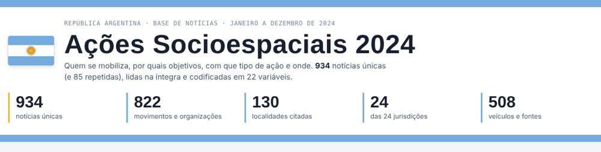
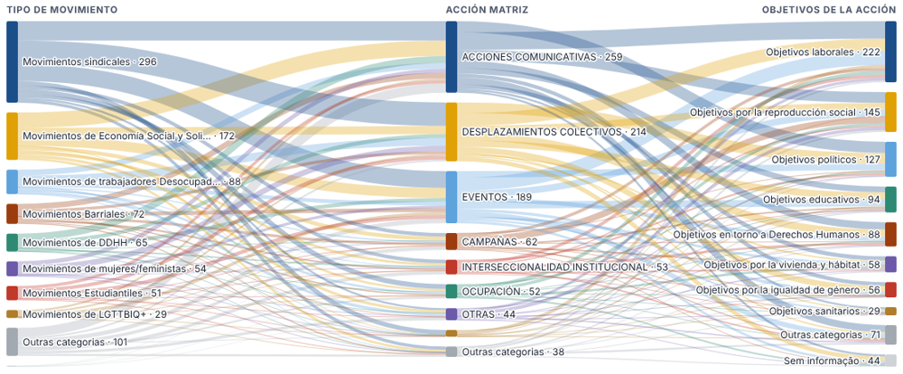
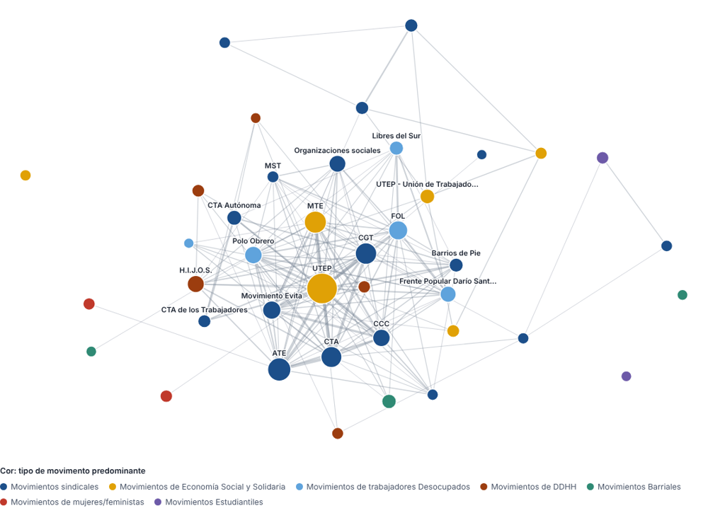
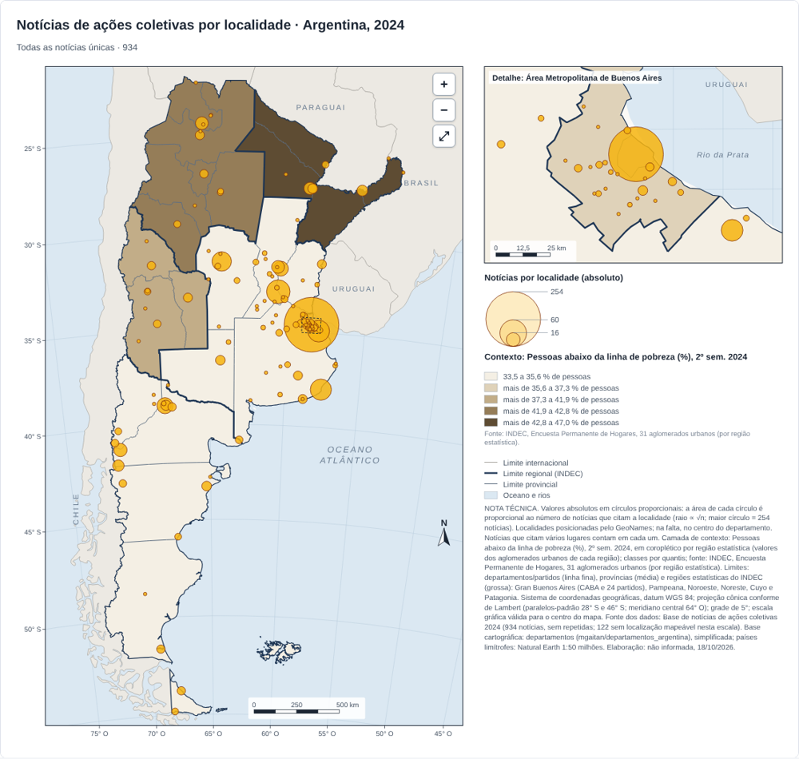

# Ações Socioespaciais na Argentina · Base interativa 2024

**Acesse:** https://wiliansventura98-collab.github.io/site-acoes/ · **Base interativa:** https://wiliansventura98-collab.github.io/site-acoes/base/

Base de dados e plataforma de visualização sobre **ações coletivas de movimentos sociais na Argentina em 2024**, construída a partir de notícias publicadas na imprensa e em meios de organizações sociais. Cada notícia foi lida na íntegra e codificada segundo quem se mobiliza, por quais objetivos, com que tipo de ação, contra ou diante de quais instituições e **onde** a ação acontece.

A plataforma permite explorar a base sem instalar nada: escolher variáveis, cruzá-las, filtrar, consultar as notícias de origem e produzir mapas temáticos com padrão cartográfico para uso em pesquisa, aulas e publicações.



## Números da base

| | |
|---|---|
| Período | janeiro a dezembro de 2024 |
| Registros | 1.019 notícias codificadas |
| Notícias únicas | 934 (85 marcadas como repetidas, excluídas por padrão) |
| Variáveis exploráveis | 22, organizadas em tempo, ação, protagonistas, instituições, espaço e fonte |
| Recorte espacial | Argentina: 6 regiões do INDEC, 24 jurisdições (23 províncias e CABA), 108 departamentos/partidos e 140 localidades citadas |

## O que a plataforma oferece

| Aba | Para quê |
|---|---|
| **Distribuição** | Frequência de qualquer variável, cruzamento entre duas variáveis em tabela de calor e filtros combináveis. |
| **Fluxos** | Diagrama de Sankey com duas ou três variáveis encadeadas (por exemplo, tipo de movimento → ação matriz → objetivos), em contagem fracionada que preserva o total do recorte. |
| **Tipologias** | Mapa de árvore da ação matriz subdividida pela ação derivada, ou de qualquer par de variáveis. |
| **Redes** | Rede de coocorrência: movimentos (ou outras categorias) que aparecem juntos nas mesmas notícias, com cor pelo tipo de movimento predominante. |
| **Mapa** | Pranchas cartográficas com círculos proporcionais (valores absolutos) e coropléticos (taxas), camadas de contexto do INDEC e do SNIC, mapas por categoria, zoom, nota técnica e exportação em PNG e SVG. |
| **Contexto** | Dispersão por província (notícias por 100 mil hab. × densidade, população ou homicídios, com correlações), panorama provincial ordenável e quadro das regiões estatísticas (pobreza, indigência, desocupação). |
| **No tempo** | Notícias por mês, calendário diário das ações por data de início e categorias mês a mês. |

Em todas as abas é possível consultar as notícias do recorte, com link para a matéria original, e baixar o recorte em **CSV**.





### Camadas de contexto nos mapas

| Camada | Recorte | Fonte |
|---|---|---|
| Densidade demográfica e população absoluta, 2022 | 24 jurisdições | INDEC, Censo 2022, resultados definitivos |
| Pobreza e indigência, 2º semestre de 2024 | 6 regiões e 31 aglomerados urbanos | INDEC, Encuesta Permanente de Hogares |
| Desocupação, 4º trimestre de 2024 | 6 regiões e 31 aglomerados urbanos | INDEC, Encuesta Permanente de Hogares |
| Homicídios dolosos por 100 mil hab., 2023 e 2024 | 24 jurisdições | Ministerio de Seguridad Nacional, SNIC |

Valores relativos aparecem em coroplético por baixo dos círculos de notícias; a população absoluta, em círculos vazados. Detalhes em [`pipeline/referencias/contexto/FONTES.md`](pipeline/referencias/contexto/FONTES.md).



## Variáveis

| Grupo | Variáveis |
|---|---|
| Tempo | Mês da notícia |
| Ação | Escala, ação virtual, modalidade, direcionalidade, ação matriz, ação derivada, objetivos, quantidade de pessoas |
| Protagonistas | Tipo de movimento, nome do movimento |
| Instituições | Tipo de instituição, nome da instituição, Objetivos de Desenvolvimento Sustentável (ODS) |
| Espaço | Região (INDEC), província, departamento/partido, localidade, localização da ação, outras localizações, dependências públicas |
| Fonte | Fonte da notícia |

As categorias mantêm os nomes originais da ficha de codificação, em espanhol.

## Notas metodológicas

- **Campos com vários valores.** Uma notícia pode ter mais de um valor numa mesma variável (vários movimentos, objetivos ou lugares). Nesses casos ela é contada em cada valor, e os percentuais podem somar mais de 100%.
- **Padronização.** Grafias equivalentes foram unificadas: maiúsculas e acentos, siglas de movimentos associadas ao nome completo, nomes dos ODS e variantes de nomes de veículos.
- **Filtros espaciais no nível do lugar.** Quando se filtra uma região, província, departamento ou localidade, só são contados e desenhados os lugares dentro dessa seleção, mesmo que a notícia também cite outros lugares (como em jornadas nacionais de protesto).
- **Semiologia cartográfica.** Valores absolutos são sempre representados por círculos proporcionais (área ∝ número de notícias) e valores relativos por coroplético, com classes por quantis.
- **Regiões.** Regiões estatísticas do INDEC: Gran Buenos Aires (CABA e 24 partidos), Pampeana, Noroeste, Noreste, Cuyo e Patagonia.
- **Localização.** As localidades foram posicionadas pelo GeoNames; quando não encontradas, pelo centro do respectivo departamento. Círculos de departamentos e províncias ficam no centróide da maior porção de terra da unidade.
- **Projeção.** Cônica conforme de Lambert (paralelos-padrão 28° S e 46° S; meridiano central 64° O), datum WGS 84.
- **Privacidade.** Nomes e e-mails de quem codificou e as observações internas de revisão não são publicados.

## Fontes

- **Dados:** base de notícias de ações coletivas na Argentina, 2024 (planilha “2024_Base_Tratada”), elaborada pelo projeto.
- **População:** INDEC, *Censo Nacional de Población, Hogares y Viviendas 2022*, resultados definitivos (novembro de 2023; total de 45.892.285 habitantes).
- **Pobreza, indigência e mercado de trabalho:** INDEC, *Encuesta Permanente de Hogares*, 2º semestre e 4º trimestre de 2024.
- **Homicídios dolosos:** Ministerio de Seguridad Nacional, SNIC-SAT, *Informe de Homicidios Dolosos 2024*.
- **Limites administrativos:** camada pública de departamentos da Argentina ([mgaitan/departamentos_argentina](https://github.com/mgaitan/departamentos_argentina)), simplificada; províncias e regiões derivadas dela.
- **Países limítrofes:** Natural Earth 1:50 milhões, via [world-atlas](https://github.com/topojson/world-atlas).
- **Localidades:** [GeoNames](https://www.geonames.org/).
- **Bibliotecas:** [D3.js](https://d3js.org/) 7.8.5, [d3-sankey](https://github.com/d3/d3-sankey) 0.12.3 e [TopoJSON Client](https://github.com/topojson/topojson-client) 3.1.0.

## Dados abertos

| Arquivo | Uso |
|---|---|
| [`dados/acoes_2024.csv`](dados/acoes_2024.csv) | Base tratada, uma linha por notícia (Excel, R, Python) |
| [`dados/dicionario.md`](dados/dicionario.md) | Dicionário de variáveis |
| [`dados/camadas/acoes_2024.gpkg`](dados/camadas/acoes_2024.gpkg) | Camadas para QGIS: localidades, departamentos, províncias (com população, densidade e homicídios), regiões (com pobreza e desocupação), aglomerados da EPH e notícias por localidade |
| [`dados/relatorio_geocodificacao.csv`](dados/relatorio_geocodificacao.csv) | Como cada localidade foi posicionada |

Detalhes em [`dados/README.md`](dados/README.md).

## Reprodutibilidade

Todo o tratamento é feito por um [pipeline em Python](pipeline/README.md): anonimização da planilha, padronização das categorias, leitura da referência espacial, geocodificação e geração dos arquivos do site e das camadas. A cada envio ao ramo `main`, o **GitHub Actions** verifica que não há dados pessoais, executa o pipeline e publica o site.

```bash
python -m pip install -r pipeline/requirements.txt
python pipeline/anonimizar.py 2024_Base_Tratada.xlsx --ano 2024
python pipeline/construir_site.py --ano 2024
```

## Estrutura do repositório

```
index.html                    página inicial
base/index.html               base interativa (estrutura da página)
assets/css/                   estilos da página inicial e da base
assets/js/app/                aplicação em módulos: núcleo, distribuição, fluxos, tipologias, redes, mapas, contexto, tempo
assets/js/vendor/             bibliotecas D3, d3-sankey e TopoJSON (cópias locais)
dados/                        dados gerados: JSON do site, CSV, GeoPackage, dicionário
dados/fonte/                  entrada do pipeline (planilha sem dados pessoais)
pipeline/                     scripts Python e referências geográficas
.github/workflows/            automação de geração dos dados e publicação
docs/                         imagens deste README
```

O site é estático: não há servidor nem banco de dados. A página carrega `dados/base.json` e `dados/geo.json` e desenha tudo no navegador.

## Responsável

Wilians Ventura Ferreira Souza · Universidade Estadual Paulista (Unesp)

Para citar a plataforma:

> SOUZA, Wilians Ventura Ferreira. *Ações Socioespaciais na Argentina: base interativa de notícias 2024*. 2026. Disponível em: https://wiliansventura98-collab.github.io/site-acoes/
