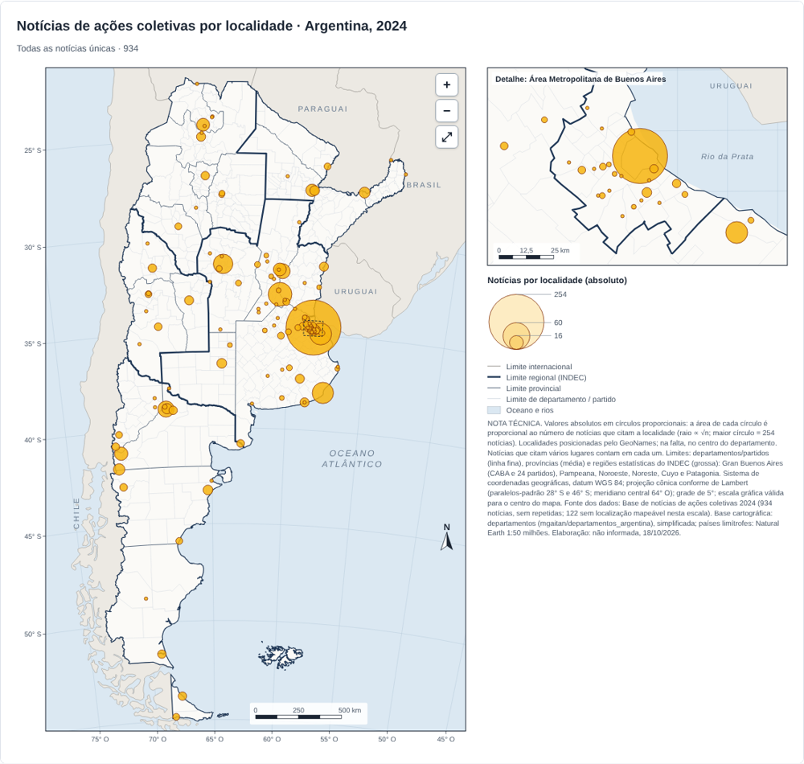
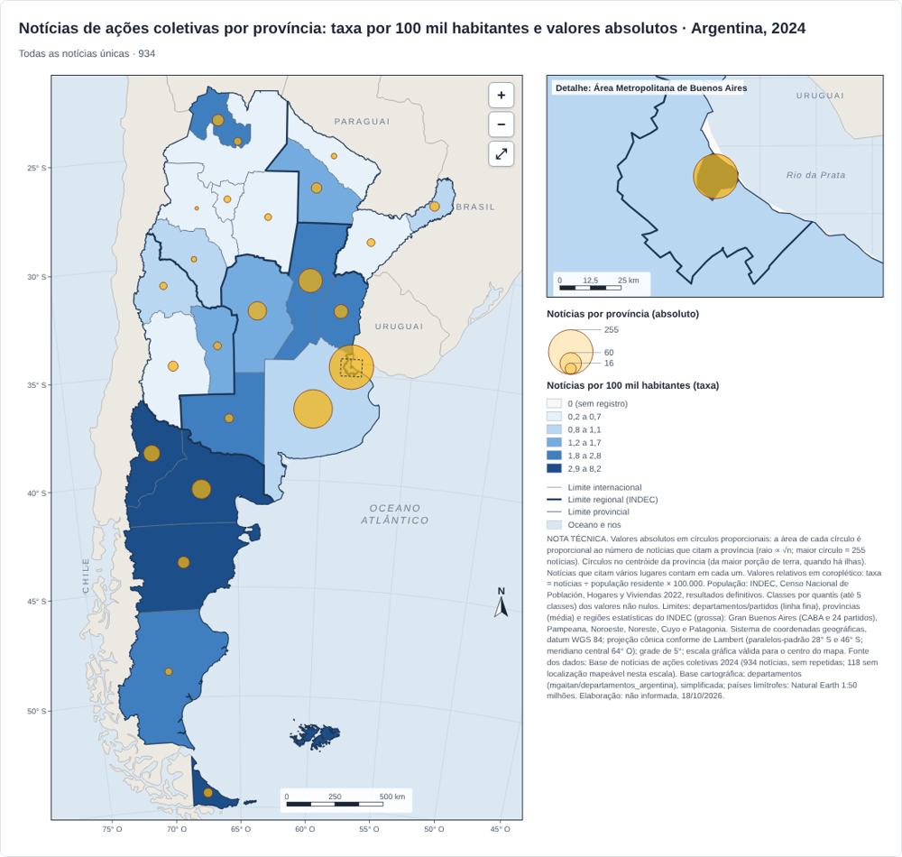

# Ações Socioespaciais na Argentina · Base interativa 2024

**Acesse:** https://wiliansventura98-collab.github.io/site-acoes/ · **Base interativa:** https://wiliansventura98-collab.github.io/site-acoes/base/

Base de dados e plataforma de visualização sobre **ações coletivas de movimentos sociais na Argentina em 2024**, construída a partir de notícias publicadas na imprensa e em meios de organizações sociais. Cada notícia foi lida na íntegra e codificada segundo quem se mobiliza, por quais objetivos, com que tipo de ação, contra ou diante de quais instituições e **onde** a ação acontece.

A plataforma permite explorar a base sem instalar nada: escolher variáveis, cruzá-las, filtrar, consultar as notícias de origem e produzir mapas temáticos com padrão cartográfico para uso em pesquisa, aulas e publicações.



## Números da base

| | |
|---|---|
| Período | janeiro a dezembro de 2024 |
| Registros | 1.019 notícias codificadas |
| Notícias únicas | 934 (85 marcadas como repetidas, excluídas por padrão) |
| Variáveis exploráveis | 22, organizadas em tempo, ação, protagonistas, instituições, espaço e fonte |
| Recorte espacial | Argentina: 6 regiões do INDEC, 24 jurisdições (23 províncias e CABA), 108 departamentos/partidos e 140 localidades citadas |

## O que a plataforma oferece

**Distribuição.** Escolha qualquer variável e veja quantas notícias há em cada categoria, com contagens e percentuais. Clique numa categoria para filtrar a base; os filtros se combinam entre variáveis.

**Cruzamento.** Cruze duas variáveis numa tabela de calor (por exemplo, tipo de movimento × província), em contagem, percentual da linha ou percentual da coluna.

**Mapas.** Pranchas cartográficas completas, prontas para publicação:

- *Valores absolutos em círculos proporcionais* por localidade, departamento/partido ou província.
- *Valores relativos em coroplético*: notícias por 100 mil habitantes, por província.
- *Combinação* de taxa (coroplético) e valores absolutos (círculos).
- *Mapas por categoria*: um mapa para cada uma das principais categorias de qualquer variável (movimentos, tipologias de ação, objetivos, regiões…), todos na mesma escala para comparação.
- Zoom e arraste no estilo dos mapas on-line, com escala gráfica, grade de coordenadas e rótulos recalculados a cada aproximação.
- Hierarquia de limites (departamentos, províncias e regiões do INDEC), países limítrofes, oceano, detalhe da Área Metropolitana de Buenos Aires, norte, legenda e **nota técnica de produção** gerada automaticamente.
- Exportação em **PNG** de alta resolução e **SVG** editável.

**No tempo.** Evolução mensal das notícias e das principais categorias da variável escolhida, em pequenos múltiplos na mesma escala.

**Notícias.** Lista das notícias do recorte, com data, título, link para a matéria original, fonte e código do documento, e exportação do recorte em **CSV**.



## Variáveis

| Grupo | Variáveis |
|---|---|
| Tempo | Mês da notícia |
| Ação | Escala, ação virtual, modalidade, direcionalidade, ação matriz, ação derivada, objetivos, quantidade de pessoas |
| Protagonistas | Tipo de movimento, nome do movimento |
| Instituições | Tipo de instituição, nome da instituição, Objetivos de Desenvolvimento Sustentável (ODS) |
| Espaço | Região (INDEC), província, departamento/partido, localidade, localização da ação, outras localizações, dependências públicas |
| Fonte | Fonte da notícia |

As categorias mantêm os nomes originais da ficha de codificação, em espanhol.

## Notas metodológicas

- **Campos com vários valores.** Uma notícia pode ter mais de um valor numa mesma variável (vários movimentos, objetivos ou lugares). Nesses casos ela é contada em cada valor, e os percentuais podem somar mais de 100%.
- **Padronização.** Grafias equivalentes foram unificadas: maiúsculas e acentos, siglas de movimentos associadas ao nome completo, nomes dos ODS e variantes de nomes de veículos.
- **Filtros espaciais no nível do lugar.** Quando se filtra uma região, província, departamento ou localidade, só são contados e desenhados os lugares dentro dessa seleção, mesmo que a notícia também cite outros lugares (como em jornadas nacionais de protesto).
- **Semiologia cartográfica.** Valores absolutos são sempre representados por círculos proporcionais (área ∝ número de notícias) e valores relativos por coroplético, com classes por quantis.
- **Regiões.** Regiões estatísticas do INDEC: Gran Buenos Aires (CABA e 24 partidos), Pampeana, Noroeste, Noreste, Cuyo e Patagonia.
- **Localização.** As localidades foram posicionadas pelo GeoNames; quando não encontradas, pelo centro do respectivo departamento. Círculos de departamentos e províncias ficam no centróide da maior porção de terra da unidade.
- **Projeção.** Cônica conforme de Lambert (paralelos-padrão 28° S e 46° S; meridiano central 64° O), datum WGS 84.
- **Privacidade.** Nomes e e-mails de quem codificou e as observações internas de revisão não são publicados.

## Fontes

- **Dados:** base de notícias de ações coletivas na Argentina, 2024 (planilha “2024_Base_Tratada”), elaborada pelo projeto.
- **População:** INDEC, *Censo Nacional de Población, Hogares y Viviendas 2022*, resultados definitivos.
- **Limites administrativos:** camada pública de departamentos da Argentina ([mgaitan/departamentos_argentina](https://github.com/mgaitan/departamentos_argentina)), simplificada; províncias e regiões derivadas dela.
- **Países limítrofes:** Natural Earth 1:50 milhões, via [world-atlas](https://github.com/topojson/world-atlas).
- **Localidades:** [GeoNames](https://www.geonames.org/).
- **Bibliotecas:** [D3.js](https://d3js.org/) 7.8.5 e [TopoJSON Client](https://github.com/topojson/topojson-client) 3.1.0.

## Estrutura do repositório

```
index.html            página inicial
base/index.html       base interativa (dados, limites e coordenadas embutidos)
assets/js/            bibliotecas D3 e TopoJSON (cópias locais)
docs/                 imagens usadas neste README
.nojekyll             publica os arquivos como estão no GitHub Pages
```

O site é estático: não há servidor, banco de dados nem etapa de compilação. Cada alteração enviada ao ramo `main` é publicada automaticamente pelo GitHub Pages em cerca de um minuto.

## Responsável

Wilians Ventura Ferreira Souza · Universidade Estadual Paulista (Unesp)

Para citar a plataforma:

> SOUZA, Wilians Ventura Ferreira. *Ações Socioespaciais na Argentina: base interativa de notícias 2024*. 2026. Disponível em: https://wiliansventura98-collab.github.io/site-acoes/
